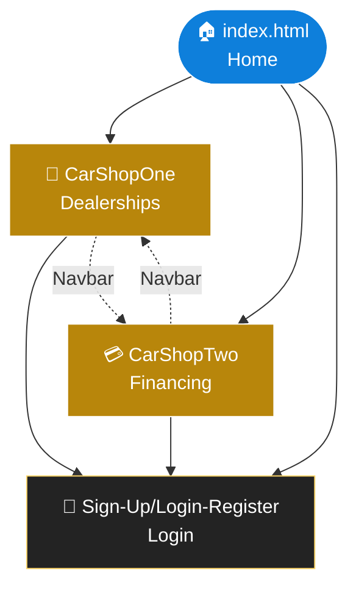
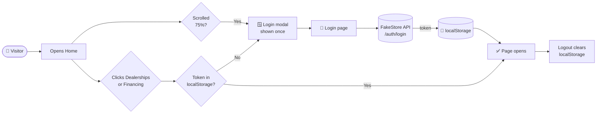
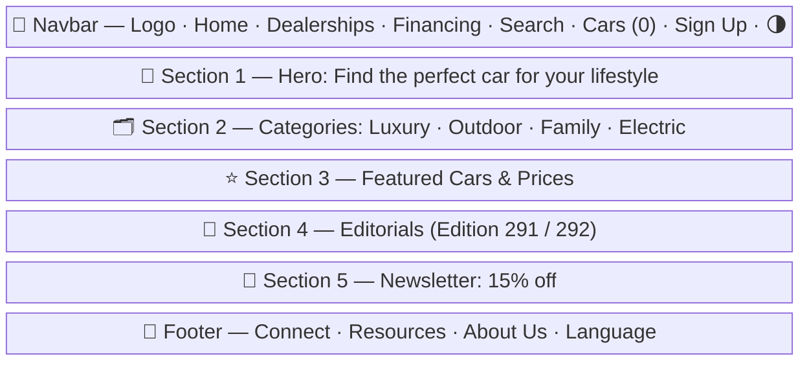
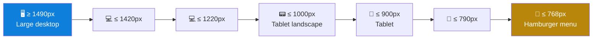

<div align="center">




<a href="https://git.io/typing-svg"></a>

<br/>


<br/>

[](https://github.com/Syed-Muhammad-Tayyab/axom-car-dealership-website-html-css-js/stargazers)
[](https://github.com/Syed-Muhammad-Tayyab/axom-car-dealership-website-html-css-js/network/members)
[](https://github.com/Syed-Muhammad-Tayyab/axom-car-dealership-website-html-css-js/watchers)

### 🚀 [**Live Demo**](https://syed-muhammad-tayyab.github.io/axom-car-dealership-website-html-css-js/) &nbsp;•&nbsp; 🐞 [**Report Bug**](https://github.com/Syed-Muhammad-Tayyab/axom-car-dealership-website-html-css-js/issues/new?template=bug_report.md) &nbsp;•&nbsp; ✨ [**Request Feature**](https://github.com/Syed-Muhammad-Tayyab/axom-car-dealership-website-html-css-js/issues/new?template=feature_request.md)


</div>

## 📑 Table of Contents

<details open>
<summary><b>Click to expand / collapse</b></summary>

1. [✨ About the Project](#-about-the-project)
2. [🎯 Key Features](#-key-features)
3. [🖼️ Screenshots & Gallery](#️-screenshots--gallery)
4. [🧰 Tech Stack](#-tech-stack)
5. [🗺️ Site Map & User Flow](#️-site-map--user-flow)
6. [📂 Repository Structure](#-repository-structure)
7. [🎨 Design System](#-design-system)
8. [⚙️ How It Works (JavaScript)](#️-how-it-works-javascript)
9. [🚀 Getting Started](#-getting-started)
10. [☁️ Deployment](#️-deployment)
11. [📱 Responsive Breakpoints](#-responsive-breakpoints)
12. [🛣️ Roadmap](#️-roadmap)
13. [❓ FAQ](#-faq)
14. [🤝 Contributing](#-contributing)
15. [📜 License & Credits](#-license--credits)
16. [👨‍💻 Developer](#-developer)

</details>


## ✨ About the Project

> **Axom** is a modern, responsive **car dealership website** where visitors can browse car categories, explore featured vehicles with prices, read blog-style editorials, check financing options, and subscribe to a newsletter for **15% off** their next purchase.

It is built with **zero frameworks and zero build tools** — just clean **HTML5**, **CSS3** and **vanilla JavaScript** — which makes it lightweight, fast, and perfect for learning how a real multi-page business website is structured.

<table>
<tr>
<td align="center" width="25%">🚘<br/><b>Browse</b><br/><sub>Luxury · Outdoor · Family · Electric</sub></td>
<td align="center" width="25%">⭐<br/><b>Discover</b><br/><sub>Featured cars with prices</sub></td>
<td align="center" width="25%">💳<br/><b>Finance</b><br/><sub>Listings, testimonials & deals</sub></td>
<td align="center" width="25%">📩<br/><b>Subscribe</b><br/><sub>15% off newsletter offer</sub></td>
</tr>
</table>


## 🎯 Key Features

| # | Feature | Description |
|:-:|---------|-------------|
| 🏠 | **Animated Home Page** | Hero section with *"Find the perfect car for your lifestyle"*, scroll-triggered reveal animations powered by `IntersectionObserver` and **Animate.css**. |
| 🗂️ | **Car Categories** | Four visual category cards — **Luxury Cars, Outdoor Vehicles, Family Cars, Electric Cars**. |
| ⭐ | **Featured Cars** | Top picks with images and prices, plus a *"View Top Picks"* call-to-action. |
| 📰 | **Editorial Section** | Blog-style editions (e.g. *How to choose the right car for your needs and budget*). |
| 🚗 | **Dealerships Page** | Car search/filter sidebar, car cards with **View Details**, featured cars, and a customer comments **slider** with auto-play (15 s) and left/right arrows. |
| 💰 | **Financing Page** | Sedans · Trucks · Electric Cars tabs, testimonials, and featured listings (Audi A8, Tesla Model X, Ford F-150). |
| 🔐 | **Sign-Up / Login Page** | Login form with **show/hide password** toggle and token-based session saved in `localStorage`. |
| 🔒 | **Gated Navigation** | *Dealerships* & *Financing* require login — guests get a friendly modal prompt. |
| 🪟 | **Smart Login Modal** | Automatically appears once when the visitor scrolls **75%** of the page. |
| 🌗 | **Dark / Light Theme** | One-click toggle, preference **persisted** in `localStorage`. |
| 🍔 | **Hamburger Menu** | Mobile-first navigation that auto-closes when the screen grows past `769px`. |
| ⬆️ | **Go-to-Top Button** | Appears after scrolling `800px`. |
| 🌍 | **Language Menu** | EN dropdown with extra language options in the footer. |
| 📩 | **Newsletter Box** | Email input with a *"15% off your next purchase"* offer. |


## 🖼️ Screenshots & Gallery

> All images below are the real assets shipped inside [`/Assets`](./Assets).

### 🏁 Hero & Categories

<div align="center">


<br/><br/>

| 💎 Luxury | 🏔️ Outdoor | 👨‍👩‍👧 Family | ⚡ Electric |
|:---:|:---:|:---:|:---:|
|  |  |  |  |

</div>

### ⭐ Featured Picks

<div align="center">

| 🚘 Car 1 · `$9,000` | 🚘 Car 2 · `$7,000` | 🚘 Car 3 · `$6,500` |
|:---:|:---:|:---:|
|  |  |  |

</div>

### 📰 Editorials

<div align="center">

| 📖 Edition 291 | 📖 Edition 292 |
|:---:|:---:|
| <br/><sub><i>How to choose the right car for your needs and budget</i></sub> | <br/><sub><i>Tips for maintaining your car's performance and longevity</i></sub> |

</div>

<details>
<summary><b>📸 More gallery — Page 2 &amp; Page 3 assets (click to expand)</b></summary>
<br/>

<div align="center">

| | | |
|:---:|:---:|:---:|
|  |  |  |
|  |  |  |
|  |  |  |

</div>

</details>


## 🧰 Tech Stack

<div align="center">


</div>

| Layer | Technology | Purpose |
|-------|-----------|---------|
| 🧱 Structure | **HTML5** | Semantic multi-page markup |
| 🎨 Styling | **CSS3** | Custom properties (variables), Flexbox, media queries, transitions, dark theme |
| ⚙️ Logic | **Vanilla JavaScript (ES6+)** | Theme switch, menu, slider, modal, auth token handling |
| 🔣 Icons | **[Boxicons 2.1.4](https://boxicons.com/)** | Navigation, password eye, hamburger |
| ✨ Animation | **[Animate.css 4.1.1](https://animate.style/)** | Fade / zoom entrance animations |
| 🔑 Auth demo | **[FakeStore API](https://fakestoreapi.com/)** | Mock `POST /auth/login` to return a token |
| 💾 Storage | **`localStorage`** | Theme preference, auth token, modal-shown flag |
| 🚀 Hosting | **GitHub Pages** | Free static hosting via included workflow |


## 🗺️ Site Map & User Flow

### 🧭 Site Map



### 🔄 Authentication & Navigation Flow



### 🏗️ Home Page Layout




## 📂 Repository Structure

```text
📦 axom-car-dealership-website-html-css-js
│
├── 📄 index.html                  # 🏠 Home page
├── 📄 README.md                   # 📖 You are here
├── 📄 LICENSE                     # ⚖️ MIT License
├── 📄 CONTRIBUTING.md             # 🤝 Contribution guide
├── 📄 CODE_OF_CONDUCT.md          # 💛 Community rules
├── 📄 .gitignore                  # 🙈 Ignored files
├── 📄 .gitattributes              # 🔧 Line-ending normalisation
├── 📄 .editorconfig               # 🧹 Consistent code style
├── 📄 .nojekyll                   # 🚫 Skip Jekyll on GitHub Pages
│
├── 📁 Css/
│   └── 📄 style.css               # 🎨 Global styles, theme variables, responsive rules
│
├── 📁 Js/
│   └── 📄 script.js               # ⚙️ Theme, menu, modal, auth gate, scroll animations
│
├── 📁 CarShopOne/                 # 🚗 Dealerships page
│   ├── 📄 CarShopOne.html
│   ├── 📄 CarShopOne.css
│   └── 📄 CarShopOne.js           # 🍔 Hamburger menu
│
├── 📁 CarShopTwo/                 # 💳 Financing page
│   ├── 📄 CarShopTwo.html
│   ├── 📄 CarShopTwo.css
│   └── 📄 CarShopTwo.js           # 💬 Testimonials slider
│
├── 📁 Sign-Up/                    # 🔐 Login / Register page
│   ├── 📄 Login-Register.html
│   ├── 📄 Login-Register.css
│   └── 📄 Login-Register.js       # 🔑 Login + show/hide password + theme
│
├── 📁 Assets/
│   ├── 📁 Logo/                   # 🏷️ Brand logo (1024×1024 PNG)
│   └── 📁 Product/
│       ├── 📁 Page 1/             # Section-1 … Section-4 images
│       ├── 📁 Page 2/             # Section-1 … Section-4 images
│       └── 📁 Page 3/             # Section-1 … Section-4 images
│
├── 📁 docs/
│   └── 📁 assets/                 # 🖼️ README banner & divider (SVG)
│
└── 📁 .github/
    ├── 📁 ISSUE_TEMPLATE/         # 🐞 Bug report & ✨ feature request
    ├── 📄 pull_request_template.md
    └── 📁 workflows/
        └── 📄 pages.yml           # 🚀 Auto-deploy to GitHub Pages
```

### 📊 Project at a Glance

| 📄 HTML Pages | 🎨 CSS Files | ⚙️ JS Files | 🖼️ Image Assets | 📏 Lines of CSS |
|:---:|:---:|:---:|:---:|:---:|
| **4** | **4** | **4** | **36** | **~2,800** |


## 🎨 Design System

Axom is styled entirely with **CSS custom properties**, so switching themes only swaps variable values — no duplicated stylesheets.

### 🎨 Color Palette

| Token | ☀️ Light | 🌙 Dark | Usage |
|-------|:--------:|:-------:|-------|
| `--main-bg` |  `#f8f8f8` |  `#000000` | Page background |
| `--nav-bg` / `--box-bg` |  `rgb(240,235,235)` |  `#0e0e0e` | Navbar & cards |
| `--name-color` |  `#232323` |  `#f8f8f8` | Primary text |
| `--header-btnH-color` |  `#0e7fdb` |  `#b8860b` | Accent / hover |
| `--card-bg-text` |  `#343434` |  `#ffffff` | Card text |
| `--footer-bg` |  `white` |  `#000000` | Footer |

### 🔤 Typography

- **Primary:** `Helvetica, Arial, sans-serif`
- **Accent / mono:** `"Courier New", Courier, monospace`

### 🌗 Theme Switching — in 3 lines

```js
document.documentElement.classList.toggle("dark");           // flip the .dark:root variables
localStorage.setItem("darkMode", document.documentElement.classList.contains("dark")); // remember it
```


## ⚙️ How It Works (JavaScript)

<details>
<summary><b>🌗 Dark / Light mode</b></summary>
<br/>

On `DOMContentLoaded` the script reads `localStorage.darkMode`; if it is `"true"`, the `.dark` class is applied to `<html>` and the toggle button gets `.active`. Each click flips the class and saves the new state.

</details>

<details>
<summary><b>✨ Scroll-reveal animations</b></summary>
<br/>

Two `IntersectionObserver`s watch elements with the classes `.hidden`, `.hiddenP`, `.hiddenCardsOne/Two/Three-p`, `.up-hidden-input` (adds `.show` once) and `.up-hidden` (adds / removes `.up-show` so the animation replays on every scroll-in).

</details>

<details>
<summary><b>🔐 Auth gate & login modal</b></summary>
<br/>

- A `token` in `localStorage` means *logged in*.
- Without a token, clicking **Dealerships** or **Financing** is intercepted (`preventDefault`) and the login modal is displayed.
- The modal also pops up **once** when the user scrolls past **75 %** (`modalShown` flag).
- The navbar button switches between **Sign Up** ⇄ **Logout** (logout = `localStorage.clear()`).

</details>

<details>
<summary><b>🔑 Login flow (demo)</b></summary>
<br/>

```js
const res  = await fetch("https://fakestoreapi.com/auth/login", {
  method: "POST",
  headers: { "Content-Type": "application/json" },
  body: JSON.stringify({ username, password }),
});
const { token } = await res.json();
localStorage.setItem("token", token);
```

> 💡 The FakeStore API is a public **mock** service — perfect for demos. Replace it with your own backend for real authentication.

</details>

<details>
<summary><b>💬 Testimonials slider</b></summary>
<br/>

`CarShopTwo.js` cycles `.slider-item` elements with `(index + 1) % length`, supports **◀ ▶** arrows and auto-advances every **15 seconds**.

</details>

<details>
<summary><b>🍔 Hamburger menu</b></summary>
<br/>

Toggles `.show` on `.hamburger-menu-items` and force-closes it on `resize` / `load` once `window.innerWidth >= 769`.

</details>


## 🚀 Getting Started

### ✅ Prerequisites

Only a modern web browser — **no Node.js, no npm, no build step.**

### 📥 Installation

```bash
# 1️⃣ Clone the repository
git clone https://github.com/Syed-Muhammad-Tayyab/axom-car-dealership-website-html-css-js.git

# 2️⃣ Go into the project folder
cd axom-car-dealership-website-html-css-js

# 3️⃣ Open it in your browser
#    • double-click index.html            (quickest)
#    • or serve it locally (recommended):
python -m http.server 5500
#    then visit → http://localhost:5500
```

<details>
<summary><b>💡 Other ways to run locally</b></summary>
<br/>

| Method | Command |
|--------|---------|
| 🟢 VS Code **Live Server** | Right-click `index.html` → *Open with Live Server* |
| 🟡 Node | `npx serve .` |
| 🔵 PHP | `php -S localhost:5500` |

</details>

### 🔑 Demo Login

The login page talks to the public **FakeStore API**. You can use one of its sample users, for example:

```text
username: mor_2314
password: 83r5^_
```


## ☁️ Deployment

This repo ships with a ready-to-go **GitHub Pages** workflow at [`.github/workflows/pages.yml`](./.github/workflows/pages.yml).

1. Push the repo to GitHub.
2. Go to **Settings → Pages → Build and deployment → Source** and choose **GitHub Actions**.
3. Push to `main` — your site goes live at:

```text
https://syed-muhammad-tayyab.github.io/axom-car-dealership-website-html-css-js/
```

Also works on **Netlify**, **Vercel**, and **Cloudflare Pages** (drag & drop the folder — no config needed).


## 📱 Responsive Breakpoints




## 🛣️ Roadmap

- [x] 🏠 Animated home page with hero, categories, featured cars & editorials
- [x] 🌗 Persistent dark / light theme
- [x] 🍔 Responsive navigation with hamburger menu
- [x] 🔐 Login page with token session & gated pages
- [x] 💬 Auto-playing testimonials slider
- [x] 📩 Newsletter call-to-action
- [ ] 🔎 Working car search & filter (make, price, type)
- [ ] 🛒 "Cars (0)" favourites / cart counter
- [ ] 📄 Individual car detail pages
- [ ] 🧮 Finance / EMI calculator
- [ ] 🌐 Real multi-language support (EN / FR / PA …)
- [ ] 🖥️ Backend (Node.js + MongoDB) for real users and inventory
- [ ] ♿ Full accessibility audit (ARIA labels, alt text, keyboard nav)

> Have an idea? [Open a feature request](https://github.com/Syed-Muhammad-Tayyab/axom-car-dealership-website-html-css-js/issues/new?template=feature_request.md) 💡


## ❓ FAQ

<details>
<summary><b>Do I need to install anything?</b></summary>
<br/>No. Open <code>index.html</code> in any modern browser and you're done.
</details>

<details>
<summary><b>Why does the login not work offline?</b></summary>
<br/>The login form calls the public FakeStore API, so it needs an internet connection. Fonts, icons, and animations also load from CDNs.
</details>

<details>
<summary><b>Can I use this for a real dealership?</b></summary>
<br/>Yes — it is MIT-licensed. Replace the demo images, prices, and the mock login with your own content and backend first.
</details>

<details>
<summary><b>How do I change the colors?</b></summary>
<br/>Edit the variables at the top of <code>Css/style.css</code> (<code>:root</code> for light, <code>.dark:root</code> for dark).
</details>


## 🤝 Contributing

Contributions make the open-source world amazing! 💛

```bash
git checkout -b feature/amazing-feature
git commit -m "feat: add amazing feature"
git push origin feature/amazing-feature
```

Then open a **Pull Request**. Please read [CONTRIBUTING.md](./CONTRIBUTING.md) and the [Code of Conduct](./CODE_OF_CONDUCT.md) first.

## 📜 License & Credits

Distributed under the **MIT License** — see [`LICENSE`](./LICENSE) for details.

| Credit | Link |
|--------|------|
| 🧱 Original Axom base project (MIT) | [MDJAmin / Axom](https://github.com/MDJAmin/axom-car-dealership-website-html-css-js) |
| 🔣 Icons | [Boxicons](https://boxicons.com/) |
| ✨ Animations | [Animate.css](https://animate.style/) |
| 🔑 Mock auth API | [FakeStore API](https://fakestoreapi.com/) |
| 🎨 README badges | [Shields.io](https://shields.io/) · [Capsule Render](https://github.com/kyechan99/capsule-render) · [Typing SVG](https://github.com/DenverCoder1/readme-typing-svg) |


## 👨‍💻 Developer

<div align="center">

<a href="https://github.com/Syed-Muhammad-Tayyab">
  
</a>

### **Syed Muhammad Tayyab**

*BSCS Student · Information Security · Full-Stack Web Developer*

[](https://github.com/Syed-Muhammad-Tayyab)

<br/>


<br/>

### ⭐ If you like this project, give it a star — it keeps me building! ⭐


**Developed with ❤️ by Syed Muhammad Tayyab**

</div>
